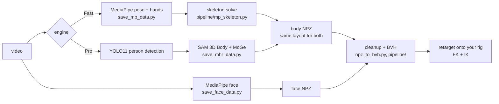

<div align="center">

# Open Mocap

### Free, open-source markerless motion capture for Blender: video in, animation out.

[](LICENSE)
[](https://www.blender.org/)
[](#requirements)

</div>

---

Open Mocap turns an ordinary video into a full **performance** (body, hands and face) and retargets it onto your Blender rig. No suit, no markers, no second camera. Record on a phone or a webcam, or use footage you already have.

It ships with **two capture engines** that you switch between per take:

| | **Fast** (MediaPipe) | **Pro** (SAM 3D Body) |
|---|---|---|
| Tracker | Google MediaPipe Pose + Hand landmarks | Meta SAM 3D Body + YOLO11 + MoGe-2 |
| Hardware | Any CPU (laptops, Macs, no GPU needed) | NVIDIA GPU recommended (CPU / AMD / Intel work, slowly) |
| Download | About 150 MB | About 11 GB |
| Speed | Near real time on a laptop CPU | Slower, best on a GPU |
| Quality | Good for most takes; weaker under heavy occlusion | Best: full 3D mesh recovery, robust to occlusion and odd angles |
| Account | None | Free Hugging Face account to accept Meta's model license |

Both engines write the **same skeleton**, so everything after capture is shared: cleanup, face capture, hand solving, BVH export, retarget presets, FK to IK, the BVH library. Start with Fast, add Pro later if you need it.

> Open Mocap is based on **[BlendCap](https://github.com/Arcomade/BlendCap) by Arcomade** (GPL-3.0-or-later). The Pro engine, the post-processing pipeline, face capture and the retargeting system come from BlendCap; Open Mocap adds the MediaPipe Fast engine, a one-click installer for both engines and the engine switch. See [Credits](#credits).

---

## Contents

- [Features](#features)
- [Requirements](#requirements)
- [Install](#install)
- [Quick start](#quick-start)
- [Documentation](#documentation)
- [How it works](#how-it-works)
- [Licensing](#licensing)
- [Credits](#credits)

---

## Features

- **Two engines, one workflow**: Fast (MediaPipe, any CPU) and Pro (SAM 3D Body, GPU), switchable in the Capture panel.
- **Single-camera, markerless capture**: full body **and** hands from one ordinary clip.
- **Finger tracking**, with controls to tune finger curl or rebuild finger motion from tracked keypoints.
- **Facial performance capture**: ARKit-style shape keys and face bones, from the same clip or a separate face clip.
- **Retarget onto your rig**: Rigify, Auto-Rig Pro, CloudRig, Mixamo and custom rigs, in **FK and IK**, with included presets and a visual bone-map editor.
- **Cleanup built in**: foot grounding and locking, footskate cleanup, depth-noise filtering, smoothing, tracking-failure repair, camera-angle correction.
- **Preview and overlay videos** to check tracking before you commit to a long capture.
- **BVH library**: keep, re-import and export takes as BVH or FBX.
- **Runs fully offline** after setup. Your footage never leaves your machine.

## Requirements

| | |
|---|---|
| **Blender** | 4.2 or newer |
| **OS** | Windows 10/11, Linux (including Flatpak Blender), macOS (Fast engine; Pro runs on Apple Silicon via PyTorch MPS, untested) |
| **Fast engine** | Any 64-bit CPU, about 1 GB free disk |
| **Pro engine** | NVIDIA RTX 20 / GTX 16 series or newer with 6 GB+ VRAM recommended; about 32 GB free disk; `git` installed |
| **Network** | Needed once for the install. Capture runs offline. |

## Install

1. **Download the add-on.** On GitHub, click **Code > Download ZIP** (or grab a release zip).
2. **Install it in Blender.** *Edit > Preferences > Add-ons*, open the menu in the top right and choose **Install from Disk...**, pick the zip, and enable **OpenMocap**.
3. **Install the engines.** In the add-on preferences click **Install Dependencies**, pick **Fast**, **Pro** or **Both**, and follow the wizard. A console window opens and does the rest:
   - fetches [uv](https://docs.astral.sh/uv/) (a small Python manager) if you don't have it,
   - builds a private Python 3.12 environment in the add-on folder (`venv/`), separate from Blender's Python,
   - downloads the models into `checkpoints/`.
4. **Restart Blender** when the console says *Done*.

**For the Pro engine** you also need a free Hugging Face account: open [facebook/sam-3d-body-dinov3](https://huggingface.co/facebook/sam-3d-body-dinov3), accept Meta's license, create a **read** token at [huggingface.co/settings/tokens](https://huggingface.co/settings/tokens), and paste it into the installer wizard. The token is only used for that download and is not saved.

**Prefer the terminal?** Run the installer directly from the add-on folder:

```bash
# Linux / macOS
bash installer/install.sh --profile fast          # or: pro, both
HF_TOKEN=hf_xxx bash installer/install.sh --profile pro
```

```powershell
# Windows
installer\install.bat --profile fast
```

On macOS, Blender can't launch the installer for you (Gatekeeper), so use the terminal command above. Full details, manual setup and troubleshooting: [docs/03-installation.md](docs/03-installation.md).

## Quick start

1. Switch to the **Performance Capture** workspace (Setup section of the Open Mocap panel), or open the **OpenMocap** tab in the 3D viewport sidebar (N panel).
2. Pick your video under **Video Source**.
3. In **Capture**, tick **Body** (and **Face** if you want facial capture), choose the engine (**Fast** or **Pro**), and click **Run Preview** to check detection.
4. Click **Run Capture**. Progress shows in the panel; an overlay video lets you check the tracking.
5. In **BVH Settings**, choose what to include (body, hands, root motion, face) and click **Generate/Reload BVH**. The animated armature appears in the scene and is saved to the BVH library.
6. In **Retargeting**, pick your rig as the target, choose a preset (Rigify, Auto-Rig Pro, CloudRig, Mixamo) or auto-match bone names, and click **Apply Retargeting**. Optionally convert to IK.

The [quick start guide](docs/04-quick-start.md) walks through this with tips for each step.

## Documentation

Everything lives in [`docs/`](docs/): installation, quick start, every capture and post-processing setting, retargeting, the BVH library, preferences, troubleshooting and filming tips. Start at the [table of contents](docs/README.md).

## How it works



- **Fast engine** ([`save_mp_data.py`](save_mp_data.py)): MediaPipe Pose (heavy) tracks 33 body landmarks in metric 3D; hands are re-detected on a crop around each wrist for full finger landmarks. [`pipeline/mp_skeleton.py`](pipeline/mp_skeleton.py) measures the performer's bone lengths, builds a T-pose skeleton with the same joint layout the Pro engine uses, solves every bone's rotation from the landmarks, and recovers the camera-space root position with a perspective solve. The result is written in the same NPZ format as the Pro engine.
- **Pro engine** ([`save_mhr_data.py`](save_mhr_data.py)): BlendCap's pipeline. YOLO11 finds the person, Meta's SAM 3D Body (127-joint body and hand model on a DINOv3 backbone, accelerated by Fast-SAM-3D-Body) reconstructs the 3D pose, and MoGe-2 estimates the camera field of view.
- **Shared pipeline** ([`npz_to_bvh.py`](npz_to_bvh.py), [`pipeline/`](pipeline/)): tracking repair, foot grounding and locking, footskate cleanup, depth denoise, smoothing, hand solving and face refinement, then BVH export. The skeleton is read from the capture file, so both engines produce the same bone names and every retarget preset works with either.
- **Blender add-on** ([`openmocap/`](openmocap/)): UI, job runner, BVH import, BVH library and the retargeting engine (FK bake, IK conversion, bone-map matching).

## Licensing

Open Mocap is licensed **GPL-3.0-or-later**. See [`LICENSE`](LICENSE) and [`NOTICE.txt`](NOTICE.txt).

It is a derivative of BlendCap by Arcomade, which is GPL-3.0-or-later; the original copyright notices are kept. The Pro engine includes the **AGPL-3.0** Ultralytics YOLO11 detector (GPL v3 section 13 allows the combination; the AGPL terms continue to apply to that component).

Models and third-party components keep their own licenses (full texts in [`licenses/`](licenses/)). Model weights are **not** stored in this repository; the installer downloads them from their official sources.

| Component | Used by | License |
|---|---|---|
| MediaPipe (Google) | Fast engine, face capture | Apache-2.0 |
| Meta SAM 3D Body | Pro engine | Meta SAM License |
| Meta DINOv3 | Pro engine backbone | Meta DINOv3 License |
| Ultralytics YOLO11 | Pro engine person detection | AGPL-3.0 |
| Fast-SAM-3D-Body | Pro engine inference | MIT (over Meta-SAM code) |
| MoGe (Microsoft) | Pro engine field of view | MIT (+ Apache-2.0 subcomponent) |
| ICT-FaceKit (USC ICT) | Face expression basis | MIT |
| PyTorch / ONNX Runtime | Pro engine runtimes | BSD-3-Clause / MIT |

> The **animation you create** is yours to use, including commercially. If you use the Pro engine, Meta's SAM License applies to the model (commercial use is allowed royalty-free, with some prohibited uses). You are responsible for having the rights to the footage you capture.

## Credits

- **[BlendCap](https://github.com/Arcomade/BlendCap)** by **Arcomade**: the original add-on this project is built from (Pro engine, cleanup pipeline, face capture, retargeting, UI). If you find this useful, please consider supporting the original author too.
- [MediaPipe](https://github.com/google-ai-edge/mediapipe) (Google)
- [SAM 3D Body](https://github.com/facebookresearch/sam-3d-body) and [DINOv3](https://github.com/facebookresearch/dinov3) (Meta)
- [Fast-SAM-3D-Body](https://github.com/yangtiming/Fast-SAM-3D-Body)
- [YOLO11 / Ultralytics](https://github.com/ultralytics/ultralytics)
- [MoGe](https://github.com/microsoft/MoGe) (Microsoft)
- [ICT-FaceKit](https://github.com/USC-ICT/ICT-FaceKit) (USC Institute for Creative Technologies)
- [uv](https://github.com/astral-sh/uv) (Astral), [PyTorch](https://pytorch.org/), [ONNX Runtime](https://onnxruntime.ai/)
- [Blender](https://www.blender.org/) and its community.
